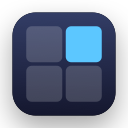

# BisectWindow

BisectWindow is a keyboard-driven window manager for macOS. You hold a prefix
chord and press arrow keys, and BisectWindow tiles the focused window into
halves and quarters or moves it to the neighbouring screen. The next action
depends on where the window already is, so short key sequences build complex
layouts.



## Features

- Tile the focused window to the left, right, top, or bottom half.
- Split a half into a quarter with a second, perpendicular arrow key.
- Move a window to the neighbouring screen with a second arrow key in the
  same direction.
- Maximize a window to the screen area outside the menu bar and the Dock.
- Show a small indicator while the prefix chord is held.

## Requirements

- macOS 14.0 (Sonoma) or later
- The Accessibility permission, which macOS requires for moving the windows
  of other apps

## Install

BisectWindow has no signed release yet. Build it from source as described in
[Development](#development), then start it:

```bash
make run
```

BisectWindow runs in the menu bar and shows no Dock icon.

## Grant Accessibility access

BisectWindow asks for the Accessibility permission on its first launch. To
grant the permission:

1. Click **Open System Settings** in the BisectWindow window.
2. Turn on **BisectWindow** in **Privacy & Security > Accessibility**.
3. Return to your work. BisectWindow detects the grant within a second and
   starts listening for keys.

If you close the window before you grant access, choose
**Grant Accessibility Access…** from the menu bar icon to open the window
again.

### If the grant has no effect

macOS stores the grant for the bundle ID together with the code signature.
If you ran a build with a different signature before, such as an unsigned
build from before you set the team ID, the list keeps that old entry. The
switch then turns on, but the current build still has no access.

To fix this, quit BisectWindow, remove the old entry, and grant access again:

```bash
tccutil reset Accessibility com.garaemon.BisectWindow
make run
```

`tccutil` can only remove grants. You still turn on BisectWindow in System
Settings after the reset. If the list shows more than one BisectWindow entry,
remove all of them with the **−** button before you grant access again.

## Usage

Hold the prefix chord, which is **Cmd + Ctrl** by default, and press one of
these keys. BisectWindow checks the rows from top to bottom and applies the
first row that matches:

| Key | Window state | Result |
| --- | --- | --- |
| Right | Against the right edge, full height | Move to the left half of the screen on the right |
| Left | Against the left edge, full height | Move to the right half of the screen on the left |
| Up / Down | Left or right half | Tile to the quarter in that corner |
| Left / Right | Top or bottom half | Tile to the quarter in that corner |
| Left / Right / Up / Down | Any other state | Tile to that half of the screen |
| F | Any | Maximize |

BisectWindow follows these rules:

- A window counts as a half or a quarter when its origin and its size are
  each within 10 points of the exact values.
- A window is against an edge, or full height, when it sits on the side of
  the key and its edges are within 50 points of the screen edges. The
  looser margin covers apps whose minimum width stops a half snap short.
- A screen move picks the screen that is geometrically adjacent. At the last
  screen in a direction, the key does nothing.
- Up and Down never move a window to another screen.
- A quarter never splits further. An arrow key on a quarter tiles to a half.
- A window that cannot be resized keeps its size and moves to the centre of
  the target area.

### Emacs

By default, Emacs rounds the frame size to whole characters and lines, so a
tiled Emacs frame falls a few points short of the target. With a large font
the gap exceeds the 10-point margin, and a second arrow key tiles to a half
again instead of a quarter. To make Emacs take the exact size, add this line
to your init file:

```elisp
(setq frame-resize-pixelwise t)
```

## Settings

Choose **Settings…** from the menu bar icon. The settings window offers these
options:

- **General:** Show or hide the indicator in the bottom-right corner of the
  main screen.
- **Key Bindings:** Pick the prefix chord from Cmd + Ctrl, Cmd + Option,
  Ctrl + Option, or Cmd + Ctrl + Shift.

## Development

### Prerequisites

- Xcode 16.0 or later
- [mise](https://mise.jdx.dev/), which installs the pinned XcodeGen version
- An Apple Development certificate, for builds that you run
- An Apple ID signed in under **Xcode > Settings > Accounts**, because
  `make build` lets Xcode fetch the provisioning profile

### Set up

1. Install XcodeGen:

   ```bash
   mise install
   ```

2. Copy the signing template and replace `YOUR_TEAM_ID` with your Apple team
   ID:

   ```bash
   cp Configs/Signing.local.xcconfig.example Configs/Signing.local.xcconfig
   ```

   The `OU=` value in this command's output is your team ID:

   ```bash
   security find-certificate -c "Apple Development" -p | openssl x509 -noout -subject
   ```

   Set the team ID in this file, not in the Signing & Capabilities editor.
   `make generate` rewrites the Xcode project and drops changes made there.

3. Generate the Xcode project:

   ```bash
   make generate
   ```

   `make build`, `make run`, and `make test` regenerate the project before
   they build, so you need this step only to open the project in Xcode.
   `make generate` skips generation when neither `project.yml` nor the list
   of source files changed. To force it, run `mise exec -- xcodegen generate`.

BisectWindow signs builds with your Apple Development certificate. A stable
signature keeps the Accessibility permission valid across rebuilds. Without
the signature, macOS ties the permission to each build, and you must grant it
again after every build.

### Build and test

| Command | Purpose |
| --- | --- |
| `make build` | Build the app. Needs the team ID. |
| `make run` | Build and start the app. |
| `make test` | Run the unit tests. Builds unsigned and needs no team ID. |
| `make logs` | Stream the unified log of Debug builds. |

GitHub Actions runs `make test` on every pull request and on every push to
`main`.

### Regenerate the app icon

`scripts/generate-app-icon.swift` draws the icon and writes every size of the
icon set. Edit the script, then run:

```bash
swift scripts/generate-app-icon.swift Sources/Resources/Assets.xcassets/AppIcon.appiconset
```

### Project structure

```
Sources/
  App/            -- Entry point, coordinator, and permission flow
  Domain/         -- Tiling and traversal logic (pure Swift, no OS dependencies)
    Models/       -- Data models (Rect, WindowInfo, AppConfig)
  Interface/      -- Protocols that separate the layers
  Infrastructure/ -- OS integrations (Accessibility, HotKey, Logging, Persistence)
  UI/             -- Overlay, permission prompt, settings, and status bar
  Resources/      -- Asset catalog with the app icon
Tests/
  LogicTests/     -- Unit tests that need no Accessibility permission
    Support/      -- Shared fixtures
scripts/          -- Development tools
```

SPEC.md describes the full design and the roadmap.
